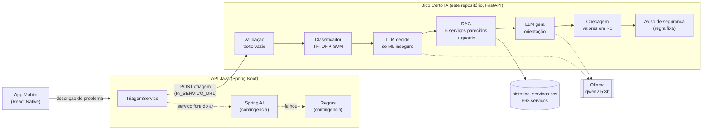

# Bico Certo IA — triagem do problema e preço justo do bairro

> **Global Solution 2026/2 · CitizenTech · Disruptive Architectures: IoT, IoB & Generative IA (FIAP)**
> Grupo **Bico Certo Labs**

O morador descreve o problema da casa ("a pia entupiu e a água não desce"). A IA identifica **que tipo de profissional chamar**, mostra **quanto os vizinhos pagaram em serviços parecidos** (faixa de preço justo) e escreve uma **orientação curta** com a pergunta certa para fazer ao prestador antes de fechar.

| | |
|---|---|
| **Este repositório** | https://github.com/kaiky06301/bico-certo-ia |
| **API Java (usa este serviço na triagem)** | https://github.com/kaiky06301/bico-certo-java |
| **App mobile** | https://github.com/kaiky06301/bico-certo-mobile |
| **API .NET (orçamentos)** | https://github.com/kaiky06301/bico-certo-dotnet |

## Integrantes

| RM | Nome completo | Turma |
|---|---|---|
| RM565733 | Erick Bernardes Bradaschia | 2TDSR |
| RM564054 | Gabriel Santos Claudino | 2TDSR |
| RM566067 | Kaiky de Oliveira Silva | 2TDSR |
| RM559523 | Lucas Fortes de Lima | 2TDSR |
| RM565060 | Jonathan Moreira Gomes | 2TDSR |

## Sumário
1. [Problema e público](#1-problema-e-público)
2. [A funcionalidade de IA](#2-a-funcionalidade-de-ia)
3. [Arquitetura](#3-arquitetura)
4. [Dados](#4-dados)
5. [Modelos, tecnologias e justificativas](#5-modelos-tecnologias-e-justificativas)
6. [Como executar](#6-como-executar)
7. [Avaliação e resultados](#7-avaliação-e-resultados)
8. [Limitações](#8-limitações)
9. [Uso responsável](#9-uso-responsável)

---

## 1. Problema e público

**Público:** moradores de bairros periféricos (piloto: Capão Redondo, Jardim Ângela, Campo Limpo) que precisam de um serviço na casa e **não sabem quem chamar nem quanto é justo pagar**, e prestadores autônomos do próprio bairro.

**Dor:** sem referência de preço, o morador aceita o primeiro valor ou desiste do serviço. O prestador honesto perde para quem cobra menos e entrega pior.

**O que a IA entrega:**
- **Categoria certa** (eletricista, encanador, pedreiro...) a partir de um texto escrito do jeito que a pessoa fala.
- **Faixa de preço justo** calculada com **serviços parecidos já feitos no bairro**, e não com a "opinião" do modelo.
- **Orientação em linguagem simples**, com uma pergunta para fazer ao prestador.
- **Aviso de segurança fixo** quando o texto indica risco (choque, faísca, gás, alagamento).

**ODS:** 10 (redução das desigualdades: informação de preço para quem tem menos acesso) e 11 (cidades e comunidades sustentáveis: economia local do bairro).

---

## 2. A funcionalidade de IA

Três técnicas trabalham juntas, cada uma no que faz melhor:

| Etapa | Técnica | Papel |
|---|---|---|
| 1. Classificar | **Machine Learning** (TF-IDF + SVM) | Decide a categoria em ~1 ms. Quando está inseguro (confiança < 0,60), pede ajuda ao LLM |
| 2. Recuperar | **RAG básico** (similaridade de cosseno) | Busca os 5 serviços mais parecidos no histórico do bairro e calcula a faixa (1º a 3º quartil dos valores pagos) |
| 3. Gerar | **IA generativa** (qwen2.5:3b local no Ollama) | Escreve a orientação usando **só** o contexto recuperado |

**Modo híbrido:** quando o classificador não tem certeza, o LLM escolhe entre as 3 categorias mais prováveis ou responde `NENHUMA` (pedido fora do escopo). Isso juntou a rapidez do ML com a "compreensão" do LLM e foi a abordagem com melhor resultado (seção 7).

**Exemplo real** (`POST /triagem` com "a pia da cozinha entupiu e a água não desce"; lista de parecidos encurtada para 1):
```json
{
  "categoria": "Encanamento",
  "confianca": 0.989,
  "decidido_por": "ml",
  "faixa": { "minimo": 125, "maximo": 145, "mediana": 130, "amostras": 5 },
  "servicos_parecidos": [
    { "descricao": "Bom dia, a pia da cozinha está entupida", "bairro": "Campo Limpo", "valor_pago": 130, "similaridade": 0.642 }
  ],
  "orientacao": "Você enfrentou a situação de a pia da cozinha estar entupida? A faixa de preço justo para esse serviço é entre R$ 125 e R$ 145. Ao contratar, você deve perguntar se o prestador pode garantir que a solução será eficaz e duradoura, evitando futuras entupimentos.",
  "origem_orientacao": "llm"
}
```
O texto tem um erro de concordância ("futuras entupimentos"), típico do modelo de 3B (ver [Limitações](#8-limitações)). A checagem garante os valores, não a gramática.

---

## 3. Arquitetura



**Fluxo ponta a ponta:**
1. O morador escreve o problema no app, que chama `POST /api/solicitacoes/triagem` na API Java.
2. Com `IA_SERVICO_URL` configurada, o `TriagemService` do Java chama `POST /triagem` deste serviço.
3. O serviço valida o texto, classifica, recupera os serviços parecidos, calcula a faixa e gera a orientação.
4. O Java confere se a categoria existe no banco e **limita a faixa à faixa de referência da categoria** (guardrail).
5. O app mostra a categoria, a faixa de preço justo e a orientação, e o pedido segue para os prestadores.

**Se algo falhar, o app continua funcionando:**

| Falha | O que acontece |
|---|---|
| Este serviço fora do ar | O Java usa a triagem com Spring AI e, se ela falhar, a triagem por regras |
| Ollama fora do ar | Categoria pelo ML, faixa pelo RAG e orientação com texto padrão (`padrao-falha-llm`) |
| LLM inventa um valor ou não cita a faixa | A resposta é descartada e entra o texto padrão (`padrao-checagem`) |
| Texto vazio ou curto demais | Pede mais detalhes (`texto-insuficiente`) |
| Pedido fora do escopo (ex.: pizza) | Não chuta categoria e pede para escolher manualmente |

---

## 4. Dados

| Arquivo | Linhas | Origem | Uso |
|---|---|---|---|
| `dados/descricoes_treino.csv` | 888 | **Simulado** por `dados/gerar_dados.py` (semente 2026) | Treino do classificador |
| `dados/historico_servicos.csv` | 668 | **Simulado** pelo mesmo script | Base de conhecimento do RAG |
| `dados/validacao_manual.csv` | 72 | Escrito à mão | Diagnóstico de erros e ajuste do vocabulário |
| `dados/teste_final.csv` | 60 | Escrito à mão, **congelado** | Avaliação final (54 no escopo + 6 fora do escopo) |

**Por que simulado:** o app ainda não tem histórico real de serviços. Os dados foram gerados com as **mesmas 9 categorias e faixas de referência da API Java** (migrations V2 e V10). O preço de cada serviço cai em uma parte da faixa conforme a complexidade (baixa 0–30%, média 25–65%, alta 60–100%), arredondado para múltiplos de R$ 5, como um prestador cobraria. **Em produção, o RAG passa a usar os serviços concluídos e avaliados no próprio app.**

**Preparação:**
- **Normalização do texto** (`motor/texto.py`): minúsculas, sem acento e sem pontuação ("Tá VAZANDO!" vira "ta vazando").
- **TF-IDF** com palavras (1 e 2 palavras seguidas) e pedaços de 3 a 5 letras. Os pedaços aproximam "entupida", "entupiu" e "entupimento" e diminuem o peso de erros de digitação. O TF-IDF já sai **normalizado (norma L2)**, o mesmo cuidado do Wine Data Set: sem normalizar, uma frase longa pesaria mais que uma curta na distância.
- **Divisão honesta:** cada descrição de treino tem um `grupo` (o modelo de frase de onde veio). A validação cruzada usa **GroupKFold**, então variações da mesma frase nunca ficam no treino e no teste ao mesmo tempo.

---

## 5. Modelos, tecnologias e justificativas

| Escolha | Por quê |
|---|---|
| **SVM linear** como classificador | Escolhido pela validação cruzada por grupo: **72,4%** contra no máximo **58,5%** do KNN (seção 7). Em texto, o TF-IDF gera milhares de dimensões e o SVM separa bem classes nesse espaço, enquanto o KNN sofre com a distância em dimensão alta |
| **KNN** comparado | Visto em aula. Testado com k = 1, 3, 5, 7, 9, 11 e 15, com distância de cosseno |
| **RAG com TF-IDF + cosseno** | Base pequena (668 serviços), então não precisa de banco vetorial nem de modelo de embeddings. Roda em milissegundos, sem custo e sem internet |
| **Faixa = 1º a 3º quartil** | Ignora valores extremos (um serviço muito caro ou muito barato não distorce a faixa). Com menos de 3 serviços parecidos, usa a categoria inteira |
| **qwen2.5:3b no Ollama** | Roda **local**, sem enviar a descrição do morador para fora (privacidade) e sem custo por chamada. 3B cabe em um notebook de 8 GB. `temperature` 0 para classificar e 0,2 para gerar |
| **Preço NÃO vem do LLM** | Modelos pequenos inventam números. A faixa é calculada com os dados e o LLM só pode repetir valores do contexto, o que é conferido pela checagem |
| **Aviso de segurança por regra fixa** | Nos testes, o modelo de 3B às vezes esquecia de avisar risco em "levei choque". Segurança não pode depender do modelo lembrar |
| **FastAPI** | Gera a documentação OpenAPI (`/docs`) e valida a entrada com Pydantic |

**Tecnologias:** Python 3.9, scikit-learn 1.6.1, FastAPI, Uvicorn, httpx, pytest, Ollama (qwen2.5:3b). No Java: Spring Boot `RestClient`.

---

## 6. Como executar

**Pré-requisitos:** Python 3.9 ou superior e [Ollama](https://ollama.com) com o modelo baixado (`ollama pull qwen2.5:3b`). Sem o Ollama, tudo funciona com texto padrão na orientação.

```bash
git clone https://github.com/kaiky06301/bico-certo-ia.git
cd bico-certo-ia
python3 -m venv .venv && source .venv/bin/activate
pip install -r requirements.txt

# 1. (opcional) regerar os dados e treinar: o modelo treinado já está em modelos/
python treinar.py

# 2. testes automatizados (o LLM é simulado, não precisa do Ollama)
python -m pytest -q

# 3. avaliação completa no teste final (precisa do Ollama rodando)
python avaliar.py

# 4. subir o serviço
uvicorn servico.app:app --port 8010
# documentação: http://localhost:8010/docs
```

**Testar sem o app:**
```bash
curl -X POST localhost:8010/triagem -H "Content-Type: application/json" \
  -d '{"descricao": "a pia da cozinha entupiu e a água não desce"}'
```

**Ligar na API Java:** suba a API Java com a variável `IA_SERVICO_URL=http://localhost:8010`. Sem ela, o Java usa só a triagem com Spring AI.

---

## 7. Avaliação e resultados

Todos os números abaixo saem de `python treinar.py` e `python avaliar.py` e ficam salvos em `resultados/`.

### 7.1 Escolha do classificador (validação cruzada no treino)

| Modelo | KFold comum | **GroupKFold (por modelo de frase)** | Validação manual (72 frases) |
|---|---|---|---|
| KNN k=1 | 100% | 53,1% ± 6,6% | 88,9% |
| KNN k=5 | 100% | 55,7% ± 6,4% | 88,9% |
| KNN k=9 | 100% | 58,5% ± 5,5% | 91,7% |
| KNN k=15 | 100% | 57,9% ± 4,9% | 88,9% |
| **SVM linear** | 100% | **72,4% ± 6,2%** | **93,1%** |

**Lição importante:** o KFold comum deu **100% para todos os modelos**. Isso é ilusão, porque as variações da mesma frase caíam no treino e no teste. Só o **GroupKFold** mostrou a diferença real entre KNN e SVM. A validação manual também ficou otimista, porque usamos os erros dela para ampliar o vocabulário do treino. Por isso existe o **teste final congelado**.

### 7.2 Teste final congelado (60 frases nunca usadas para ajustar nada)

| Abordagem | Acerto geral | Acerto no escopo (54) | Fora do escopo detectado (6) | Tempo médio |
|---|---|---|---|---|
| Regras (palavras-chave) | 68,3% | 64,8% | 6/6 | < 1 ms |
| ML (TF-IDF + SVM) | 73,3% | 74,1% | 4/6 | 1 ms |
| LLM sozinho (qwen2.5:3b) | 70,0% | 66,7% | 6/6 | 340 ms |
| **Híbrido (ML + LLM)** | **83,3%** | **81,5%** | **6/6** | 224 ms |

**Interpretação:** o híbrido acerta **10 pontos a mais** que o melhor método isolado e é **mais rápido que o LLM sozinho**, porque o LLM só é chamado quando o ML está inseguro. O ML sozinho não reconhece bem o que está fora do escopo (4/6). O LLM resolve isso respondendo `NENHUMA`.

### 7.3 RAG: o preço sugerido chega perto do valor real?

*Leave-one-out* nos 668 serviços do histórico: cada serviço é escondido, o RAG recupera os 5 mais parecidos e a mediana deles é comparada com o valor que foi pago de verdade.

| Método | Erro médio | Erro médio (%) |
|---|---|---|
| Sem RAG (mediana da categoria inteira) | R$ 102,70 | 37,6% |
| **Com RAG (mediana dos 5 parecidos)** | **R$ 59,10** | **20,1%** |

O RAG **reduz o erro do preço sugerido quase pela metade**, porque "trocar a fiação" e "trocar uma lâmpada" são da mesma categoria, mas têm preços muito diferentes.

### 7.4 Geração e situações de falha

| Teste | Resultado |
|---|---|
| Respostas do LLM aprovadas pela checagem (9 frases do teste final) | 9/9 |
| Ollama fora do ar: continua classificando e usa texto padrão | OK |
| Texto vazio: pede mais detalhes | OK |
| Pedido fora do escopo ("quero pedir uma pizza") | OK, não chuta categoria |
| Checagem barra valor inventado ("Custa uns R$ 500") | OK |
| Integração: Java chama o serviço e o app recebe a faixa do RAG | OK (registrado no log do serviço) |
| Integração: serviço fora do ar e o Java cai para o Spring AI | OK |

**Testes automatizados:** `python -m pytest -q` roda **16 testes** (normalização, classificador, quartis, RAG por categoria, checagem de valores, falha do Ollama, texto vazio, fora do escopo, aviso de segurança e API). O LLM é simulado com `httpx.MockTransport`.

---

## 8. Limitações

- **Dados simulados.** O histórico de preços foi gerado, não coletado. Os números do RAG mostram que o **método** funciona, mas a faixa real só vale depois de o app acumular serviços concluídos.
- **O mesmo grupo escreveu o treino e o teste.** Mesmo com o teste congelado, frases de usuários reais devem ser mais variadas (gírias, erros de digitação, áudio transcrito). O próximo passo é medir com pedidos reais do app.
- **Erros que continuam no teste final (híbrido):** "levei choque ao encostar na geladeira" virou Pequenos reparos, "o assoalho de taco está soltando" virou Pedreiro, e quatro casos inseguros foram parar em Encanamento ("a moto está com a corrente frouxa", "aplainar a porta..."). O modelo de 3B parece preferir a primeira opção da lista quando não entende. Um modelo maior ou exemplos no prompt devem reduzir isso.
- **Modelo pequeno.** O qwen2.5:3b às vezes escreve frases estranhas. A checagem garante os **valores**, mas não a qualidade do texto. Em produção, um modelo maior (7B ou API) melhora a redação.
- **Faixa de preço é referência, não tabela.** O valor final depende do que o prestador encontrar no local. O app mostra a faixa como "o que vizinhos pagaram", não como preço fixo.
- **Sem foto.** A triagem usa só o texto. Visão computacional sobre a foto do problema é um próximo passo natural.

---

## 9. Uso responsável

- **Sem credenciais:** o modelo roda local, então não há chave de API. As URLs vêm de variáveis de ambiente (`.env.example`), e `.env` está no `.gitignore`.
- **Sem dados pessoais:** as bases não têm nome, telefone nem endereço, só descrição do problema, bairro, valor e nota. Como o modelo é local, a descrição digitada pelo morador **não sai da infraestrutura do app**.
- **A IA não decide sozinha:** a categoria precisa existir no banco, a faixa é limitada à referência da categoria e o morador pode trocar a categoria manualmente.
- **Transparência:** cada resposta informa `decidido_por` (ml ou llm) e `origem_orientacao` (llm ou texto padrão), para o app e a equipe saberem de onde veio cada informação.
- **Segurança em primeiro lugar:** o aviso de risco é uma regra fixa e não depende do modelo.
